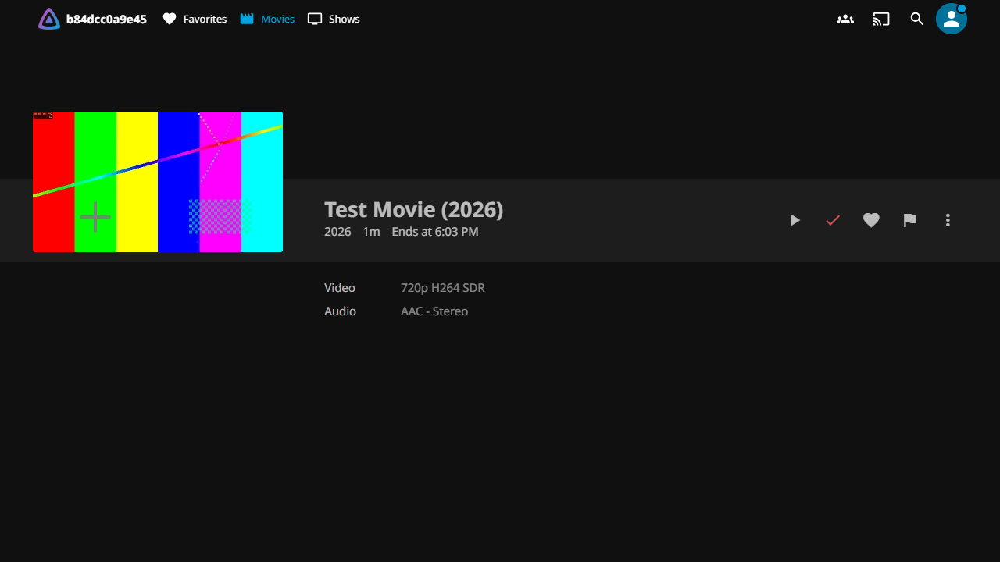
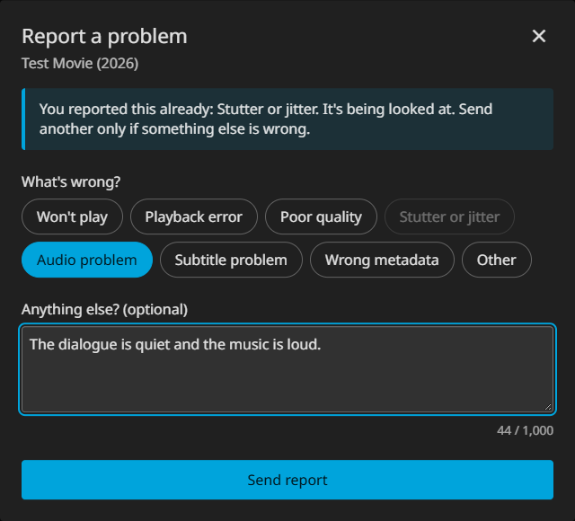
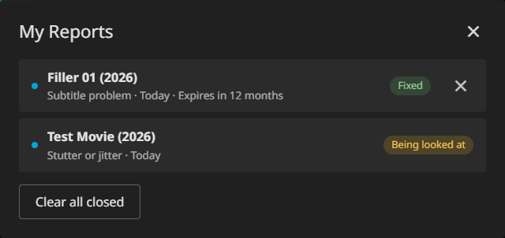
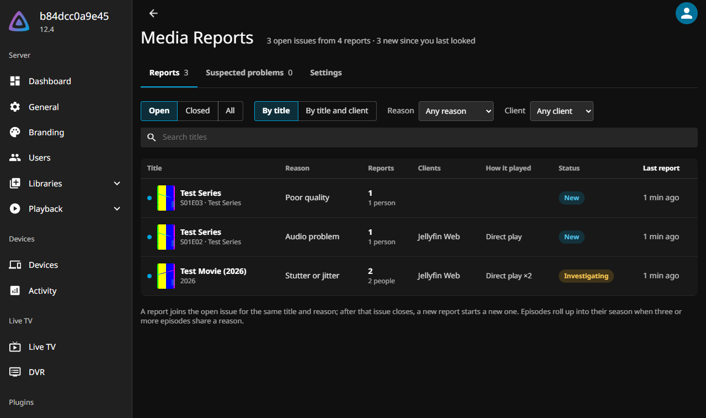
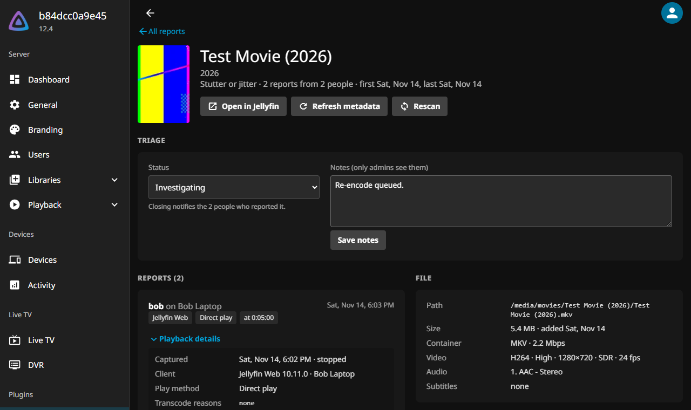
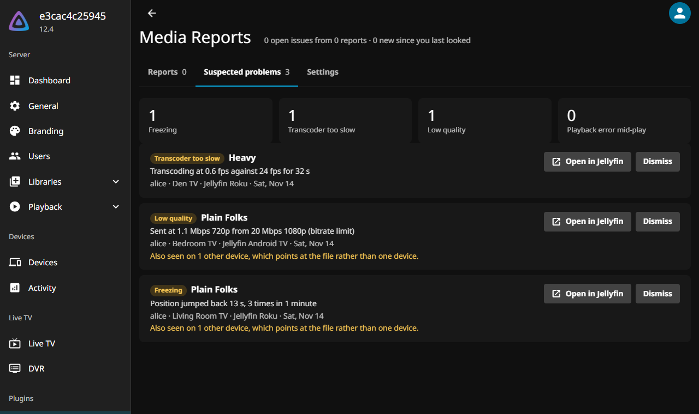

<p align="center">
  <picture>
    <source media="(prefers-color-scheme: dark)" srcset="assets/logo/readme-dark.svg">
    
  </picture>
</p>

# Media Reports for Jellyfin

Media Reports is a Jellyfin server plugin for finding out when playback goes wrong for the people who use your server. Users report a problem with a movie, show, season or episode from a Report button in the app. The plugin also watches playback on every app, TV apps included, and lists what looks wrong without anyone pressing a button. You work both from one page in the Dashboard.

Each report carries the playback details the server already knows: the app and device, direct play or transcode and why, the codecs and the position. The user only picks a reason.

This is an unofficial, third-party plugin. It is not affiliated with or endorsed by the Jellyfin project.

## Features

**For users**

- A **Report a problem** button (a flag) after the favourite button on movie, episode, season and series pages, and in the video player.
- A short dialog: pick a reason (Won't play, Stutter or jitter, Audio problem and so on), add a note if they want, send.
- **My Reports** in the user menu: each report with its status and history, a dot when something changed, and a short on-screen notice when a report is resolved while the app is open. A report can be withdrawn while it is still new.

<p align="center">
  
</p>
<p align="center">
  
  
</p>

**For admins**, on the **Media Reports** page in the Dashboard menu:

- **Reports:** reports on the same title for the same reason are one issue, so a problem is worked once however many people hit it. Show open or closed issues, filter by reason and app, search titles, split a row by app to tell a file problem from an app problem, and see a season's episodes rolled up into one row.
- **An issue:** every report with its playback details, the file, a status (New, Investigating, Fixed, Won't fix, Duplicate, Can't reproduce, and Replaced – verify, which the plugin sets when the file changes), private notes and the full history. **Refresh metadata** and **Rescan** run on that title only.
- **Suspected problems:** what the plugin noticed on its own, by kind: freezing, a transcoder slower than the video, low quality, and direct play failing mid-play. Each finding names the title, user, device and app, and what the server saw ("Transcoding at 3.1 fps against 24 fps for 52 s").
- **Replaced files:** when a title's file is replaced, its open reports follow it and the issue is set to Replaced – verify.
- **Alerts:** each new report goes to a Discord webhook, a generic JSON webhook and Jellyfin's activity log within a minute. The page also warns when the Report button has stopped loading in every app, which usually means a Jellyfin update broke it.
- **Metrics** for Prometheus, with counts only.

<p align="center">
  
</p>
<p align="center">
  
</p>
<p align="center">
  
</p>

## Which apps get the Report button

The button lives inside jellyfin-web, so it appears in the apps built on it:

| App | Report button | Suspected problems |
|---|---|---|
| Jellyfin Web, in a desktop or phone browser | Title pages and the player | Yes |
| Jellyfin for Android | Title pages; in the player only when its video player setting is **Web player** | Yes |
| Jellyfin for webOS | Title pages and the player | Yes |
| Jellyfin for Android TV, Roku and other native apps | No | Yes |

Native apps don't run jellyfin-web, so a plugin can't add anything to them. Playback there is still watched, and problems show under **Suspected problems**. The iOS app loads the same web client, so the button may appear there, but it isn't tested.

## How the Report button reaches Jellyfin Web

Jellyfin has no way for a plugin to add a button to its web client, so Media Reports changes jellyfin-web's `index.html` as the server sends it:

- It adds one `<script>` tag for its own `reporter.js` before `</head>`, and nothing else.
- It never writes jellyfin-web's files on disk. Uninstall the plugin, or turn reporting off, and the page is served as it was.
- It asks Jellyfin for the page uncompressed so it can add the tag, so `index.html` (and only that page) is sent without gzip or Brotli. A reverse proxy that compresses responses still compresses it.
- It does not need File Transformation. Plugins that change the page through File Transformation, such as Jellyfin Enhanced, keep their changes: Media Reports only inserts its tag into the page it is given, and leaves a page that already carries the tag alone, so the page gets exactly one.

## Install

Media Reports needs Jellyfin 12.0 or later 12.x (`targetAbi` 12.0.0.0). It is tested on 12.0, 12.1 and 12.2.

1. In the Jellyfin dashboard, open **Plugins → Repositories** and add this repository URL:

   ```
   https://pathimmersive.github.io/jellyfin-plugin-media-reports/manifest.json
   ```

2. Open **Plugins → Catalog**, install **Media Reports**, and restart the server.
3. Reload Jellyfin Web. The Report button is on title pages, and **Media Reports** is in the Dashboard menu.

Jellyfin checks each download against the checksum in the repository manifest.

## Settings

Open **Media Reports** in the Dashboard menu, then **Settings**. Changes apply without a restart; apps pick them up on their next page load.

- **Reasons:** what users pick from. Rename, reorder, add or retire reasons. Renaming keeps the reason on its reports; a retired reason is no longer offered but stays on the reports that used it.
- **Reporting:** **Let users report problems** is on in a fresh install. Off removes the Report button and My Reports from every app and refuses new reports. Reports already filed stay.
- **Suspected problems:** one switch per kind, all on by default. A kind switched off adds no new findings.
- **Alerts:** a Discord webhook address, a generic webhook address that gets one JSON POST per batch of reports, and **Send a test alert**. With both empty nothing is sent; the activity log entry is written either way.
- **Metrics:** the section shows the metrics address (`/MediaReports/Metrics` on your server) and a Prometheus scrape config to copy. Create an API key in **Dashboard → API Keys** for the scrape. The weekly digest, paging and routing belong in your own monitoring.
- **Keeping reports:** closed reports are deleted after 365 days by default; 0 keeps them forever. **Export all reports** downloads every report, issue and history entry as one JSON file.

A user can file at most 30 reports an hour.

## Update

When a new version is released, Jellyfin offers it under **Plugins → My Plugins** from the same repository URL. Install it and restart the server. Reports, issues and settings are kept. Users get the new Report button on their next page load; there is nothing to clear.

## Uninstall

1. In **Plugins → My Plugins**, uninstall **Media Reports** and restart the server. The Report button is gone at the next page load in each app.
2. The reports database is left in place in case you reinstall. To remove every report, delete the `media-reports` folder in the server's data folder (`/config/data/media-reports` in the official Docker image).

## Troubleshooting

**No Report button.**

- Check that **Let users report problems** is on in Settings, then reload the page. An app opened before the change needs a reload.
- In Jellyfin for Android the player has the button only with the **Web player** setting; title pages always have it.
- Native TV apps never show it; see [Which apps get the Report button](#which-apps-get-the-report-button).
- Open `/web/index.html` on your server and look for `MediaReports/web/reporter.js` in the page source. If it isn't there, check the server log for lines from Media Reports. A reverse proxy or CDN that caches `index.html` can keep serving the page from before the install; clear its cache.

**"The Report button hasn't loaded in any app for 7 days."** Apps built on jellyfin-web played something in those 7 days, but none of them loaded the button. This usually follows a Jellyfin update that changed the web client. Check the troubleshooting steps above, look for a newer Media Reports version, and open an issue if there is none.

**No alert arrives.** Use **Send a test alert** in Settings: it shows, per address, whether the webhook accepted the message. A failed alert is logged as a warning and retried once after 30 seconds.

**The metrics answer 401 or 403.** The metrics need an API key from **Dashboard → API Keys**, sent as `Authorization: MediaBrowser Token="<key>"`, as in the scrape config the Settings tab shows.

**"You've sent 30 reports in the past hour."** The limit keeps one account from flooding the list. It clears an hour after the earlier reports.

**A report shows no playback details.** The server keeps each user's last 10 playbacks for 24 hours, in memory only. A report filed after a restart, or long after the playback, has none.

## Privacy and stored data

Suspected problems watching is on by default. From the moment the plugin is installed it watches playback on every app and records each user's playback problems: the title, the user's name, the device and app, and what the server saw. Findings are kept 30 days. Turn a kind off under **Settings → Suspected problems**, and tell your users the server does this.

Everything stays on your server. Data leaves it only through the webhooks and the metrics endpoint you set up yourself. Admins see everything; a user sees only their own reports, never the file path or your notes.

[What the plugin stores](docs/data.md) lists every table and column, where the files are, who sees what, and how long each thing is kept.

## Versioning

Versions are `major.minor.patch`; Jellyfin shows them with a fourth part, `0.1.0.0`.

- **Patch** (0.1.1): fixes only.
- **Minor** (0.2.0): new features. Settings and stored reports carry over.
- **Major**: a change to the HTTP API or to stored data that can't carry over. The API version in `GET /MediaReports/Info` changes with it.

Before 1.0.0 a minor version may also change the API; [CHANGELOG.md](CHANGELOG.md) says so when it does.

| Media Reports | Jellyfin |
|---|---|
| 0.1.x | 12.0 and later 12.x |

Each release's notes, and the changelog Jellyfin shows in the catalog, are its entry in [CHANGELOG.md](CHANGELOG.md).

## API for other clients

Any Jellyfin client can file and follow reports through the plugin's HTTP API. Call `GET /MediaReports/Info` to check the plugin is installed. [docs/api.md](docs/api.md) covers every route, with its sign-in, request, answer and error codes.

## Build from source

You need the .NET 10 SDK (pinned in `global.json`) and, for the load checks, Docker.

```bash
dotnet test                          # build and run the unit tests
bash scripts/smoke-load.sh           # load the plugin into Jellyfin 12.0, 12.1 and 12.2 containers
bash scripts/repo-install-check.sh   # install it from a local plugin repository into a Jellyfin container
```

`scripts/package.sh` builds a release zip and its manifest entry. See [CONTRIBUTING.md](CONTRIBUTING.md) for how changes are made.

## License

[GPL-3.0-or-later](LICENSE). Third-party components are listed in [THIRD_PARTY_NOTICES.md](THIRD_PARTY_NOTICES.md).
